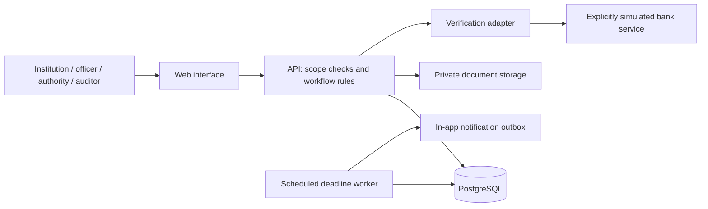

# Proposed system design

## Architecture

Use a modular monolith for the prototype: one web application, one API, one relational database, private document storage and a scheduled worker. This keeps workflow changes transactional and reduces operational work.

Proposed baseline: React with TypeScript for the interface, FastAPI for the API, PostgreSQL for records, and S3-compatible private object storage. Confirm against team experience before scaffolding. Keep worker code in the same repository; an additional queue service is unnecessary until workload warrants it.

## Separate the dimensions of status

A single status enum cannot represent this domain. A mature instrument may still be awaiting verification and have a pending release request. Model these dimensions separately:

| Dimension | Values / behavior |
| --- | --- |
| Submission | Draft → submitted → under scrutiny → correction requested → resubmitted → accepted or rejected |
| Verification | Not requested, pending, confirmed, mismatch, unavailable; scoped to the exact instrument version |
| Time | Upcoming, due today, matured; derived from maturity date, reference date and thresholds |
| Lifecycle | Current, superseded, released, cancelled; transitions require recorded reasons and authority |
| Request | Draft → submitted → scrutiny → clearances pending → decision pending → approved/rejected → completion recorded |

Document review acceptance and independent bank confirmation are separate facts. Maturity alone does not authorize release. Approval alone does not establish refund completion. Missing bank support produces “verification unavailable,” never a successful bank confirmation.

Dashboard “expiring” is a date filter, “pending” is a workflow filter, and “renewed” is a linked-history filter. Explain overlaps rather than implying every tile is an exclusive bucket. Track contractual validity separately from maturity where the instrument has both.

## Core records

| Entity | Key fields and constraints |
| --- | --- |
| Institution | Internal ID, supplied AICTE identifier, name, region, ownership/type, scope assignments |
| User / role assignment | Identity reference, role, institution or jurisdiction scope, enabled state |
| Instrument | Institution, type, bank/branch, reference, amount in integer paise, currency, issue/maturity/validity dates, lifecycle, row version |
| Instrument version | Immutable submitted field snapshot, submitter, timestamp, predecessor version |
| Document version | Instrument/request link, storage key, media type, size, checksum, version, uploader, malware-scan status |
| Verification attempt | Exact instrument version, adapter/channel, simulated flag, external reference, timestamp, outcome, evidence document |
| Field evidence | Field name, claimed value, extracted suggestion, confirmed value, provenance, reviewer disposition |
| Discrepancy | Field/rule, observed values, severity, owner, open/resolved status, resolution reason |
| Renewal link | Previous/new instrument IDs, reason, reviewer and effective date; disallow cycles |
| Release request | Instrument/version, request type, reason, requester, policy version, workflow state, decision, completion evidence |
| Clearance | Request, required bureau/type, assigned officer, pending/granted/refused, evidence, timestamp |
| Policy version | Effective dates, instrument/institution applicability, document checklist, approval rules, reminder thresholds |
| Notification / outbox | Recipient, case, threshold, due date, channel, unique deduplication key, delivery attempts |
| Audit event | Actor, action, object/version, timestamp, correlation ID, change summary, reason |

Use explicit date-only fields for instrument dates, UTC timestamps for events, and Asia/Kolkata for the demo deadline calendar. Define the maturity boundary as date equal to today = due today; earlier date = matured. Never use binary floating point for money.

## Workflow invariants

- Institution users cannot read or mutate another institution's records, including through export and document URLs.
- Officials operate only within assigned scope. Browser role switches are not authorization.
- Once submitted, corrections create a version. Evidence retains its original version and field scope; dependency rules determine applicability to later versions. Material changes require fresh evidence for affected facts. Administrative edits do not invalidate unrelated confirmation. Source freshness and revocation are evaluated separately. See the USP challenge review for acceptance tests.
- A replacement remains pending until accepted; closing the predecessor is an explicit authorized action with an effective date.
- A release decision requires the configured checklist and clearances. Proposed control: requester and final approver must be different users.
- Only an authorized role can record release completion, with documentary evidence. The system retains the decision separately.
- Each workflow mutation and its audit event commit in one database transaction. Version checks prevent competing decisions from silently overwriting one another.
- Notifications use an outbox and idempotency keys so retries do not create duplicate reminders. Recheck current case state before dispatch.
- Policy changes apply through recorded versions. Existing decisions retain the policy snapshot used to reach them.

## API slices

Start with `/instruments`, `/instruments/{id}/versions`, `/documents`, `/verification-attempts`, `/discrepancies`, `/renewals`, `/release-requests`, `/clearances`, `/notifications`, `/reports` and `/audit-events` under `/api/v1`.

Expose actions such as submit, request-correction, accept, decide and record-completion through dedicated endpoints with server-enforced transitions. Do not allow arbitrary status updates through generic object patches.

## Security implementation requirements

Use a maintained identity provider and authenticated server sessions; require stronger authentication for privileged users in deployment. Apply server-side scope checks to every record lookup. Store secrets outside source control and use TLS plus encryption at rest in deployment.

Uploads enter quarantine: enforce allowed formats, size limits and content checks; scan before serving. Keep object storage private and issue short-lived authorized download links. Audit access to sensitive documents without placing account numbers, document contents or credentials in logs.

Application roles must not update or delete audit events. This is application-level protection, not a claim of immunity to database-administrator tampering. Stronger tamper evidence requires separately controlled retention or signed checkpoints. Backup restoration, retention/deletion policy and incident handling remain deployment work.
