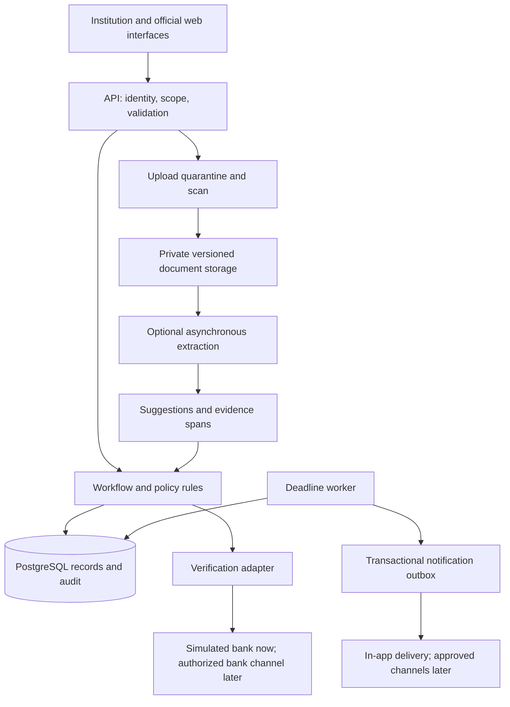

# SIH 2026 PS 26265 — Evidence-based research and solution proposal

Research date: **28 October 2026, Asia/Kolkata**. Working product name: **NidhiSetu**. Status: research and proposed design; no software or measured impact has been delivered yet.

## 1. Official statement and requirement baseline

| Field | Supplied statement |
| --- | --- |
| ID | 26265 |
| Exact title | Streamline of security deposit/ FDR portal. |
| Organization / department | AICTE / Regulation Bureau |
| Category / theme | Software / Smart Automation |
| Domain interpretation | Regulatory administration, financial-document workflows and secure information management |
| Team skills / deadline | Skills not supplied. User confirmed deadline within two days; stack and full-build effort estimates remain provisional |

The [complete supplied statement](source/problem-statement.txt) is preserved verbatim. Metadata comes from the user's screenshot; description comes from the user's pasted statement. A live SIH listing and the number of available statements were not independently verified. This report treats the supplied statement as the project baseline, not as authority to access government or banking systems.

In simple language: institutions submit deposits and supporting evidence; AICTE needs one reliable place to review them, confirm details through authorized channels, watch deadlines, request corrections and process release requests with an attributable history.

| Official capability | Proposed response | Evidence needed in prototype |
| --- | --- | --- |
| 1. Central repository | Institution and instrument records with scoped search | Persisted records and filtered results |
| 2. Digital documents | Private, versioned document storage | Authorized retrieval and retained prior versions |
| 3. Verification/discrepancies | Separate claimed, extracted and confirmed values | Match, mismatch and unavailable-channel cases |
| 4. Validity/maturity | Date rules and scheduled action generation | Boundary-date tests under a fixed clock |
| 5. Renewal/replacement | Explicit predecessor/successor links | Pending replacement cannot erase original history |
| 6. Release/refund workflow | Checklist, clearances, competent decision and completion evidence | Blocked and authorized transitions |
| 7. Alerts/escalation | Configurable thresholds, owner and escalation queue | Idempotent reminders and overdue actions |
| 8. Dashboard/reports | Filter-backed counts, work queues and exports | Counts reconcile with saved cases |
| 9. Audit/access | Server-enforced scope and transactional audit records | Negative access checks and complete event trail |
| 10. Integration/security | Adapter boundaries and protected data | Simulated integrations clearly labeled; security checks |

**Stated requirements:** those ten capabilities, complete deposit lifecycle, distinction between institution information and independent confirmation, authorized integration where feasible, and measurable prototype evaluation.

**Our design choices:** field-level provenance, separate status dimensions, maker/checker separation, PostgreSQL, a modular monolith, optional OCR and a synthetic bank adapter. These are recommendations, not quoted SIH mandates. No fixed reminder intervals, bank APIs, deposit amounts, universal release eligibility, or mandatory AI model are specified in the supplied statement.

## 2. Executive recommendation

Build a **workflow-first, evidence-aware portal**. Deliver every required administrative flow with deterministic rules and human decisions. Add OCR to reduce typing only after saved records, authorization, date monitoring and release controls work.

The most useful differentiator is a version-bound evidence view: for each consequential field, show what the institution claimed, what a document parser suggested, what an authorized source confirmed, and which discrepancy remains unresolved. A corrected amount creates a new version and triggers fresh confirmation rather than inheriting an old verified badge.

This direction matches the statement without depending on unavailable banking permissions or an unvalidated fraud model. It is an integration and workflow contribution; it is not a claim to have invented digital deposits, provenance or human review.

## 3. Problem analysis and root causes

The supplied statement describes fragmented records and manual correspondence. The causal model below is an interpretation to validate with officers and institutions, not an observed field study.

| Root cause hypothesis | Operational consequence | Design response |
| --- | --- | --- |
| Institution and instrument references are inconsistently recorded | Duplicate or unlinked cases; slow search | Stable IDs, normalized fields, duplicate-review signals |
| Documents and decisions live in separate channels | Hard to establish the evidence behind a status | Case-linked documents, observations and decisions |
| Dates are tracked manually | Late renewals and repetitive follow-up | Scheduled thresholds, assigned actions and escalation |
| A document upload is confused with verification | Unsupported confidence in the financial record | Explicit provenance and confirmation scope |
| Release routing is opaque | Institutions cannot identify pending prerequisites | Checklist and clearance dependencies with owners |
| Mutable records hide earlier values | Difficult audit reconstruction | Submitted snapshots and immutable document versions |

Affected users are institution representatives, scrutiny officers, clearance-providing bureaus, competent authorities and auditors. Banks are external evidence providers where supported. Administrators operate identity and configuration; they should not automatically acquire financial decision authority. Institutions benefit from visible next actions, officers from a usable work queue, and auditors from reconstructable decisions. Students are indirect beneficiaries of sound institutional administration; this is not a student fee-refund application.

The hardest constraints are authoritative evidence access, policy variation, document heterogeneity, legacy record quality, access boundaries and adoption. No public evidence reviewed establishes the actual case volume, loss rate, officer workload or turnaround time for this particular bureau. Those must be measured during discovery.

## 4. Existing landscape: what is already solved elsewhere

These are adjacent systems and research components, not proven substitutes for the complete SIH portal. Documented capability does not establish a feature's absence elsewhere.

| System / work | Documented mechanism and maturity | Strength | Boundary relative to this statement |
| --- | --- | --- | --- |
| **AICTE existing approval process** | Published handbook describes release applications, evidence and clearances through its web portal; operational administrative process | Existing policy context and institution relationships | We have not inspected the authenticated implementation; cannot claim AICTE has no portal or no tracking. [AICTE handbook](https://www.aicte.gov.in/sites/default/files/APH%20Final.pdf) |
| **NeSL e-BG** | Bank-issued electronic guarantees, beneficiary access, renewal requests and integration facilities; documented live service | Issuer-connected evidence and lifecycle pattern | A bank guarantee is not an FDR; coverage, contracts and bank participation must be established separately. [NeSL FAQs](https://www.nesl.co.in/faqs/) |
| **NIC eOffice** | Electronic file routing, noting, approvals, signatures and document repository; government product suite | Reusable administrative workflow concepts | Public description does not establish an AICTE FDR data model or bank-verification integration. Could be an integration destination. [NIC eOffice](https://www.nic.gov.in/project/eoffice/) |
| **PFMS** | Government financial management and payment tracking; beneficiary-validation/payment status interfaces | Useful reference for separating administrative approval from payment outcome | Beneficiary/account validation is not proof of an FDR's issuance, lien or validity. [PFMS](https://training.pfms.gov.in/Home.aspx), [government tracking guide](https://dbtdge.ncs.gov.in/uploads/download_pdf/Know_payment_status_DBTMIS.pdf) |
| **Camunda 8** | General process orchestration with human tasks; established software product | Could express complex evolving workflows | Adds deployment and licensing overhead; official licensing for version 8.6+ requires production licensing for major self-managed components. [Product plans](https://camunda.com/pricing/), [license documentation](https://docs.camunda.io/docs/reference/licenses/) |
| **Tesseract** | Maintained OCR engine, Apache-2.0 code | Useful local baseline without a cloud OCR dependency | Produces text, not authoritative instrument confirmation or regulatory decisions. [Official repository](https://github.com/tesseract-ocr/tesseract) |
| **LayoutLMv3** | Multimodal pretrained document model tested on forms, receipts and related tasks; research model/code | Learns text, image and spatial relationships | Domain evaluation and license review needed; upstream project content uses CC BY-NC-SA 4.0. [Huang et al., 2022](https://arxiv.org/abs/2204.08387), [upstream license](https://github.com/microsoft/unilm/blob/master/layoutlmv3/README.md) |

The AICTE base handbook is an initial reference rather than a complete current policy specification. All applicable addenda and delegation rules must be reconciled before deployment; this review did not authenticate a consolidated current release-rule set. Keep demonstration policy visibly separate from operational policy.

### Research papers and what we can responsibly borrow

| Paper | Method and evaluation status | Useful implication | Limitation |
| --- | --- | --- | --- |
| **Huang, Lv, Cui, Lu and Wei, LayoutLMv3, ACM Multimedia 2022** | Unified text/image masking and alignment; document-task benchmark experiments | A spatial model is a reasonable candidate if template variation defeats a simpler parser | Published document-task scores do not estimate FDR accuracy. [Original paper](https://arxiv.org/abs/2204.08387) |
| **Shu, Wang, Wang, Mai and Wan, LAVA, FinNLP 2025** | Retrieval, layout-aware extraction, enrichment and symbolic/arithmetic checks; evaluated financial-document framework | Keep extraction separate from rule validation and retain attributable intermediate evidence | Does not provide AICTE-specific eligibility or bank confirmation. [Proceedings and metadata](https://aclanthology.org/2025.finnlp-2.7/), [paper](https://aclanthology.org/2025.finnlp-2.7.pdf) |
| **Nitesh Kumar, Beyond Logprobs, 23 June 2026** | Multi-signal extraction-confidence estimation, evaluated on DocILE and CORD; accessed as arXiv manuscript, whose comments report workshop acceptance | If automating extraction, evaluate abstention and calibration rather than trusting the model's verbal confidence | This review did not independently reproduce results or verify workshop proceedings. It is not FDR-authentication validation. [Original manuscript](https://arxiv.org/abs/2606.24420) |
| **Ilechukwu, Hong and Nag, JRFM 19(4), 2026** | Issuer/document hierarchy, hashes and off-chain files on a permissioned Ethereum-compatible proof of concept | Provenance requires an authorized issuer relationship, not just a checksum | Functional PoC; broader performance, revocation and expiry are future work. [Publisher article](https://www.mdpi.com/1911-8074/19/4/239) |

These papers justify design experiments; they do not establish our product's accuracy, legal compliance, operational deployment or novelty.

## 5. Consensus contribution and evidence checks

The requested Consensus extension was not exposed as a callable connector, and plugin discovery returned no match. **Consensus's web interface was successfully used instead**, without purchasing a plan or creating an account. The [research thread](https://consensus.app/search/new-thread/6aF177SMSTGxjxREgihxsw/) contains the query and synthesis; persistence of an unsigned-in thread is not guaranteed.

Query: *What evidence supports human-in-the-loop document information extraction and provenance tracking for reliable financial document verification? Compare rule-based OCR with layout-aware transformers, and distinguish field extraction from authenticity verification.*

Consensus supplied leads on extraction confidence, symbolic validation and issuer-bound provenance. We independently checked the strongest leads against arXiv, ACL Anthology and the publisher. One concrete correction: Consensus labeled LAVA as 2026, whereas the ACL proceedings identify it as **November 2025**; this report cites the proceedings. We did not import the synthesis's cross-paper performance percentages as comparable FDR results. The [research log](05-consensus-and-source-log.md) records what was used and excluded.

## 6. Defensible gaps and limits of the evidence

| Gap / opportunity | Evidence and confidence | Proposed response | Validation still needed |
| --- | --- | --- | --- |
| Complete AICTE-specific administrative lifecycle | Explicitly requested by supplied statement; strong requirement evidence | Unified submission, review, renewal and release cases | Map actual bureau SOP and current portal behavior |
| Claims can outlive the evidence that supported them | Statement requires submitted/confirmed distinction; our version-staleness risk is an engineering inference | Bind confirmations to instrument versions and show provenance | Replay corrections and check invalidation rules |
| Extraction alone does not enforce business rules | LAVA separates extraction from auditable rule validation; strong adjacent research evidence | Deterministic policy checks and human decisions | Test institution-specific policies with authorized staff |
| Public form/receipt benchmarks are not FDR benchmarks | FUNSD, CORD and DocILE document different domains | Synthetic FDR test suite and later permissioned pilot | Obtain lawful, representative de-identified samples |
| Deadline alerts need operational accountability | Statement asks reminders, escalations and pending-case visibility | Owner, deadline and resolution evidence per action | Interview officers about recipients and escalation rights |
| Cross-organization trust remains an integration dependency | NeSL illustrates issuer-connected evidence for e-BGs, not general FDR access | Bank adapters with explicit unsupported state | Verify available bank channels and contracts |

Sources for the dataset-domain observation: [FUNSD](https://guillaumejaume.github.io/FUNSD/), [CORD](https://github.com/clovaai/cord), [DocILE](https://docile.rossum.ai/). Evidence for the validation distinction: [LAVA](https://aclanthology.org/2025.finnlp-2.7.pdf). Evidence for the adjacent bank-integration pattern: [NeSL](https://www.nesl.co.in/faqs/).

These are application opportunities, not a systematic-review finding that no prior solution exists. No exhaustive patent search or authenticated competitor audit was performed. Avoid pitching centralization, OCR or blockchain alone as novel.

## 7. Three technically distinct approaches

### A. Deterministic workflow and rules portal — recommended foundation

Structured institution entry → document upload → rule checks → officer scrutiny → authorized evidence channel → reminders → renewal/release workflow. Use explicit state transitions, relational constraints and date rules. No trained model is necessary.

Required inputs: policy configuration, institution records, synthetic instruments and document fixtures. Proposed tools: React/TypeScript, FastAPI, PostgreSQL, private object storage and scheduled Python jobs. No special hardware beyond development laptops and modest server resources is needed for the synthetic prototype.

Advantages: predictable decisions, straightforward tests, low integration coupling and complete statement coverage. Limitation: users still type details and staff still review evidence; this cannot manufacture bank connectivity. Major risk is encoding an incorrect policy as a rule. Validate with fixtures and an officer-reviewed checklist before any pilot.

Planning estimate: **180–260 team person-hours**, assuming relevant web skills; elapsed time depends on parallel availability. Prototype hosting allocation: **₹0–₹3,000 for a month**, not a vendor quotation, excluding student labor and existing hardware. Local demonstration can avoid hosting expenditure.

### B. Document-AI-first ingestion with supervised exceptions

Upload → image normalization/text extraction → OCR or multimodal extraction → schema normalization → field confidence and evidence spans → rule checks → human confirmation → the same administrative lifecycle.

Candidate algorithms: deskewing, text-layer extraction, Tesseract baseline, template anchors/regex, and a layout-aware model if justified. Optional calibrated classifier routes uncertain fields to review. Training needs representative labeled FDRs, which are not currently available. Generic forms help tool development but cannot establish deployment readiness.

Advantages: potential typing reduction and faster review of heterogeneous documents. Limitations: uncertain generalization, labeling effort, inference cost, license restrictions and automation bias. Test per-field exact match, critical false acceptance, abstention coverage and unseen-layout performance. Keep the full manual path usable.

Planning estimate: **280–440 person-hours** including the workflow foundation; **₹2,000–₹10,000 experimental budget ceiling** for hosting/inference or short GPU experiments, subject to actual provider selection. This is a planning allowance, not current pricing. A laptop CPU suffices for baseline experiments; advanced model training may require additional compute.

### C. Issuer-attested documents with a permissioned provenance network

A participating bank issues a signed attestation or registers an issuer-linked document digest; AICTE verifies issuer authority, signature, status and instrument version before using the evidence in its workflow. A permissioned ledger is one possible shared registry; signed messages plus a conventional registry are a simpler alternative.

Candidate standards/tools: W3C Verifiable Credentials for issuer claims and status, cryptographic signatures, and optionally a permissioned ledger with off-chain document storage. The [W3C VC 2.0 Recommendation, 15 May 2025](https://www.w3.org/TR/vc-data-model-2.0/) provides an issuer/holder/verifier data model; the [Ilechukwu et al. PoC](https://www.mdpi.com/1911-8074/19/4/239) demonstrates an issuer/document hierarchy on a permissioned chain.

Advantages: direct issuer provenance and potential multi-party evidence sharing. Limitations: issuer onboarding, key custody, status/revocation, governance, contracts and bank participation dominate feasibility. Hashing an uploaded fake only preserves a fake. A ledger does not establish that money remains deposited or that a release is legally authorized.

Validate signature failure, unknown issuer, expired/revoked attestation, changed file, key rotation and unavailable registry. Use simulated issuers for a PoC; do not label this a participating-bank network. Planning estimate: **320–520 person-hours** for a lab implementation including the portal; **₹3,000–₹15,000 lab infrastructure allowance**. Real onboarding cost and duration are unknown and excluded.

### Comparative decision

All ratings are our qualitative assessment for an assumed student team, not benchmark measurements.

| Criterion | A: workflow/rules | B: AI-first | C: issuer network |
| --- | --- | --- | --- |
| Student feasibility | High with web skills | Medium; data/model skills needed | Low for live service, medium for lab PoC |
| Innovation opportunity | Evidence/version UX and accountability | Extraction and confidence routing | Cross-party provenance |
| Prototype cost | Lowest | Variable inference/labeling cost | Extra infrastructure/governance |
| Scalability | Indexes and bounded jobs | Also limited by extraction throughput | Also limited by consortium operations |
| Implementation effort | 180–260 person-hours | 280–440 person-hours | 320–520 person-hours |
| Reliability | Explicit rules; human evidence dependency | Adds model errors and drift | Strong cryptography under trusted issuers; governance dependency |
| Official alignment | High across all ten requirements | High only if lifecycle is also delivered | Partial unless complete portal is also built |

**Choose A and add a narrow B module later.** Keep C as an interoperability option if a bank partner actually supports it. This order maximizes demonstrable requirements per unit of student effort.

## 8. Recommended proposal and workflow

**Problem definition:** provide a timely, attributable, institution-wise view of deposit evidence and actions without confusing document submission, independent confirmation, administrative approval and completed release.

**Working principle:** every instrument has stable identity, versioned claims, source-attributed evidence, separate workflow/date states and a next action. Human authority remains explicit.

1. Institution selects its case, enters instrument fields and uploads supporting records.
2. API validates scope and format; document enters quarantine and then authorized storage after checks.
3. Submission freezes a version, opens scrutiny and creates an audit event atomically.
4. Officer checks documents and rules; discrepancies get owners and correction requests.
5. Verification adapter records channel, evidence, outcome and exact confirmed version. Unsupported channels remain unavailable.
6. Institution correction creates a version; material changes require fresh confirmation.
7. Worker computes maturity/validity actions and creates deduplicated notifications and escalations.
8. Renewal/replacement creates a linked record, preserving original history until an authorized effective transition.
9. Release request gathers the configured prerequisites; separate authority records a decision.
10. Authorized staff record the appropriate NOC/sanction/discharge/refund completion evidence according to the validated process. Approval is retained separately from completion.

Must-have features: repository, documents, evidence comparison, discrepancies, date jobs, renewal links, release routing, in-app notifications, reports, authorization and audit. Advanced features: OCR prefilling, bulk import, email/SMS, SSO, real bank adapters, digitally signed outputs and multilingual help.

### Architecture and data flow

Store submission and audit writes in a transaction; store file objects through a staged upload/finalization protocol so failed writes do not create apparently complete submissions. Keep operational state in PostgreSQL, binary documents in private storage and extraction artifacts linked by document/version IDs. Use correlation IDs across jobs and requests.

### Technology decisions and simpler alternatives

| Component | Proposed choice and reason | Simpler alternative / trigger to change |
| --- | --- | --- |
| Web UI | React + TypeScript for forms and evidence comparisons | Server-rendered templates if team is faster with them |
| API | FastAPI/Python for validation and optional document pipeline | Django or an existing team stack is equally reasonable |
| Database | PostgreSQL for transactional workflow and reporting | SQLite for single-user throwaway demo only; do not imply multiuser parity |
| Documents | Private S3-compatible storage through an abstraction | Private local volume for local prototype; authorization still required |
| Jobs | Scheduled worker with database outbox and unique keys | Add a broker only for demonstrated throughput/retry needs |
| Identity | Maintained OIDC identity provider and server-side roles | Seeded test identities for synthetic local demonstration only |
| OCR | Text extraction then Tesseract baseline | No OCR until manual workflow is complete |
| Policy | Versioned typed configuration and named rule functions | Dedicated workflow/rule engine only if policy complexity warrants it |

Technology selections are architectural judgment, not claims of superior benchmark performance. Pin supported dependency versions at implementation and record licenses. Avoid microservices, a vector database or a blockchain as default dependencies.

### Data-management design

Core entities: Institution; User; scoped RoleAssignment; Instrument; InstrumentVersion; DocumentVersion; VerificationAttempt; FieldEvidence; Discrepancy; RenewalLink; ReleaseRequest; Clearance; PolicyVersion; NotificationOutbox; AuditEvent.

Instrument fields include type, reference, bank/branch, amount in integer paise, currency, issue/maturity/validity dates, institution ID, lifecycle and concurrency version. Evidence stores source/channel, observation time, verified fields, document/version, provider reference, reviewer and simulated flag. Requests retain the policy snapshot used for a decision. Use a separate related party/entity if the deposit owner differs from the submitting institution.

Maintain independent submission, verification, date, lifecycle and request states. An instrument can be matured, awaiting confirmation and subject to a release request simultaneously. Exports and tiles must explain overlapping categories. Use India-local calendar dates for demo deadlines and UTC timestamps for events. A maturity date equal to the reference date is due today; earlier dates are matured.

Important constraints: no renewal-link cycles; no unscoped object lookup; no silent mutation of submitted snapshots; no inherited confirmation after material changes; no arbitrary status patch; row-version conflict on concurrent decisions; no requester self-approval under the proposed maker/checker control.

### Security, privacy and operational readiness

Enforce authorization at object, action, document and export levels on the server. Require strong authentication for officials, short-lived sessions, private storage, transport encryption and managed secrets. Keep sensitive fields out of logs. Treat documents and OCR content as untrusted; no document text can invoke tools or override workflow rules.

Quarantine uploads, enforce size and extension allowlists, inspect actual type, generate storage names and scan content before retrieval. These recommendations follow [OWASP File Upload](https://cheatsheetseries.owasp.org/cheatsheets/File_Upload_Cheat_Sheet.html) and [Authorization](https://cheatsheetseries.owasp.org/cheatsheets/Authorization_Cheat_Sheet.html) guidance; they still require implementation and testing.

For a real deployment, identify personal data in signatory names, contact details and attachments; document purpose, lawful processing basis, retention, access and processor arrangements. Do not assume all institutional financial information is personal data or that consent alone governs every regulatory workflow. The **13 November 2025 DPDP Rules notification has staggered commencement**; legal applicability must be mapped to deployment timing and actual processing rather than claiming blanket compliance. [Official MeitY Gazette, rule 1](https://www.meity.gov.in/static/uploads/2025/11/53450e6e5dc0bfa85ebd78686cadad39.pdf)

CERT-In's directions specify reporting certain incidents within six hours and secure rolling 180-day ICT logs in Indian jurisdiction for covered entities. Treat incident handling, clock synchronization and log governance as operational design work; these directions do not define the full retention period for deposit documents. [CERT-In directions, 28 April 2022](https://www.cert-in.org.in/PDF/CERT-In_Directions_70B_28.04.2022.pdf)

Append-only application permissions make history harder to alter through the app; they do not make a database immune to administrators. Consider independently controlled retention and signed audit checkpoints for stronger assurance. Restore backups in a test environment, not merely check that files exist.

### Low connectivity, accessibility and scale

Support server-saved drafts, resumable/retryable uploads, explicit sync status and small paginated responses. For MVP, final submission and approval require connectivity. Avoid caching financial documents in browser service workers. A later encrypted offline-draft design needs a device-loss threat model and conflict handling.

Use keyboard-accessible forms, visible focus, programmatic labels, text explanations for status colors, readable contrast, responsive layout and screen-reader announcements. Test manually with keyboard and a screen reader. GIGW 3.0 references WCAG 2.1 and is the appropriate government-web planning reference; conformance is not established by a checklist alone. [Official GIGW scope](https://guidelines.india.gov.in/scope-and-objective/)

Scale first with indexes on institution, assigned officer, pending status and due date; paginate lists; put OCR outside request handling; batch jobs and bound exports. Tenant/jurisdiction checks must survive every optimization. Measure using synthetic load before giving institution-count capacity claims.

### Deployment and maintenance

Prototype: reproducible local containers, migrations, synthetic seeds and a fixed demo clock. Optional private demo deployment uses separate test identities and synthetic files. No production credentials or official logos implying endorsement.

Pilot: authority-approved environment, real identity integration, security review, backup/restore procedure, migration reconciliation and controlled scope. Operations require policy owners, support staff, access reviews, patch management, job monitoring, incident response and licensed/authorized integration arrangements. Deployment is future work, not completed compliance.

## 9. Data and AI validation

No authoritative public AICTE FDR training or fraud dataset was located in this review. That is a search limitation, not proof that none exists.

| Data source | Verified contents / scale | License/access | Appropriate use |
| --- | --- | --- | --- |
| [FUNSD](https://guillaumejaume.github.io/FUNSD/), Jaume, Ekenel and Thiran, 2019 | 199 annotated scanned forms | [Terms](https://guillaumejaume.github.io/FUNSD/work/) restrict use to noncommercial research/education and discuss underlying image rights | Tool familiarization and form-extraction experiments; not FDR evidence |
| [CORD](https://github.com/clovaai/cord), Park et al., 2019; v2 release 2022 | 1,000 receipts, 800/100/100 train/dev/test | [Dataset CC BY 4.0 file](https://github.com/clovaai/cord/blob/master/LICENSE-CC-BY); check applicable code/data files | Receipt parser development; substantial domain mismatch |
| [DocILE](https://docile.rossum.ai/), Šimsa et al., 2023 | Official site lists 6,680 annotated and 100,000 synthetic business documents, plus almost 1M unlabeled | Research access form; [repository](https://github.com/rossumai/docile) code is MIT, which does not automatically license the dataset | Business-document extraction baseline; confirm dataset agreement before download |
| Team synthetic FDR set | Proposed 150 documents across six invented layouts; not yet generated | Team-created assets with recorded generation rules and no copied bank seals | Deterministic validation, layout robustness and repeatable demo |

Synthetic design: vary amounts, references, dates, scan quality, rotation, missing fields, multi-page attachments, duplicate files and contradictory claims. Store ground truth separately. Label altered examples as consistency/tamper-test fixtures, not a representative fraud corpus.

Baseline sequence: manual form → PDF text extraction → OCR plus field anchors/regex → optional layout-aware model. Normalize separators, currency and date formats while retaining raw text. Never silently guess an ambiguous date or account/reference digit. Return null/needs-review for absent fields.

If training an extractor, label field spans/bounding boxes, group split by institution/template/source, tune thresholds only on development data and reserve unseen layouts for test. Prevent augmented copies of the same source document crossing splits. A proposed 90/30/30 synthetic split can exercise the harness but cannot estimate real deployment accuracy. No model has been trained or evaluated in this project.

Measure exact-match precision/recall per field, normalized amount/date accuracy, document-level all-critical-fields accuracy, false acceptance of wrong critical values, human correction time and error rates by scan condition/layout. If confidence drives automation, report calibration and risk-versus-coverage, including how many cases abstain. Evaluate OCR failure separately from extraction and policy failure. Bank verification requires its own authorized reference outcomes.

Privacy and bias: do not upload real financial files to external model providers without appropriate authorization and processing terms. Performance on one language, bank layout or scan quality cannot justify general claims. Monitor rejection and correction rates across document groups; give every user a manual correction route.

## 10. Novelty, IP and positioning

The strongest implementable feature is the **version-bound evidence comparison and action history**. Show a changed amount invalidating earlier confirmation, explain the precise mismatch and preserve the reviewer decision. It is useful, testable and tightly tied to the supplied statement.

Position the solution as adapting proven workflow, evidence and monitoring patterns to AICTE's institution/deposit lifecycle. Do not claim first-ever OCR verification, a fraud-proof portal, automatic bank integration or nationwide readiness. A cryptographic digest demonstrates byte consistency relative to a recorded digest, not issuer legitimacy on its own.

No patentability or freedom-to-operate opinion is established here. Maintain attribution, third-party license inventory and original implementation records. Before commercial deployment or a patent filing, conduct a qualified prior-art/license review. In particular, research-code and model licenses may differ from permissive framework licenses.

## 11. Roadmap, responsibilities and cost

Assumption: six contributors with basic web experience. Responsibilities are work packages, not instructions to spawn agents. The actual deadline and skills remain unknown.

| Phase | Deliverables and owner | Dependencies | Main risk / exit condition |
| --- | --- | --- | --- |
| 1. Requirements/research | Domain lead: traceability, glossary, policy questions, research log | Supplied statement and official references | Incorrect policy assumption; label provisional rules |
| 2. Design/setup | UI lead + backend lead: flows, schema, identity scopes, migrations, seeds | Phase 1 | Over-design; one runnable vertical slice |
| 3. Core development | Backend lead: cases/rules/audit; UI lead: submission/detail; documents lead: safe storage; jobs lead: reminders | Shared contracts and fixtures | Mock-only features; persist every key transition |
| 4. Integration/testing | QA/deployment lead: scope tests, worker retries, concurrency, release checks; domain lead reviews outcomes | Core transitions | Status drift; prove negative scenarios |
| 5. Validation/demo | All contributors: measured baseline, private demo/local fallback, five-minute run, judge Q&A | Stable feature freeze | Invented claims; every slide tied to evidence |

**Deadline update:** the user confirmed that submission is due within two days. The full approach estimates above are not a promise to finish that scope before submission. Prioritize a defensible proposal, permitted submission materials and a small working flow. Do not make the submission depend on finishing OCR, live banking, a production identity system or every lifecycle screen. Use the [48-hour submission pack](06-two-day-submission-pack.md) as the controlling delivery plan. Exact submission time, required portal fields and mandatory artifact format still need confirmation.

For approach A, allocate up to ₹3,000 for optional prototype hosting/storage and retain a local fallback. Labor is excluded, not free. An illustrative pilot budget envelope is ₹8,000–₹25,000/month for infrastructure/support tooling only; it is an internal allowance, **not a researched vendor quote or government procurement estimate**. Real bank integration, SSO, security certification, messaging, staff and maintenance need separate quotes. Do not use these envelopes as production TCO.

Estimate actual cost from measured units: compute-hours × rate + document GB-month × rate + operations/egress + notification charges + identity/support + backup/security operations. Measure documents per case, retained versions and retention duration before sizing storage. For example, 10,000 cases × 3 files × 2 MB × 2 versions is approximately 120 GB before backups—an illustrative workload, not observed AICTE volume.

## 12. Risks and failure responses

Likelihood and impact are qualitative planning judgments.

| Risk | Likelihood / impact | Mitigation and required response | Pre-demo test |
| --- | --- | --- | --- |
| Bank channel unavailable | High / high | Explicit pending/unavailable state; authorized manual follow-up | Adapter timeout and unsupported bank |
| OCR returns wrong amount/date | High if added / high | Evidence spans, human confirmation, null for ambiguity | Blur, rotation, ambiguous dates and absent fields |
| Wrong release policy | Medium / critical | Versioned approved policy; block when unresolved | Missing prerequisite and outdated policy |
| Cross-institution access | Medium / critical | Server-side scope for records/files/exports | Direct ID and signed-link negative tests |
| Malicious document/parser load | Medium / high | Quarantine, scan, resource limits and isolated processing | Wrong type, oversized file and parser timeout |
| Old verification survives correction | Medium / high | Version-bound evidence and invalidation | Change confirmed amount/reference |
| Duplicate/racing reminders | Medium / medium | Unique keys, outbox and state recheck | Concurrent worker runs and retry |
| Two authorities decide concurrently | Medium / high | Transaction plus row version | Race conflicting decisions |
| Approval mistaken for completed payment | Medium / high | Separate decision and completion evidence | Approve without settlement evidence |
| Insider changes audit history | Medium / high | Restricted permissions, separate checkpoints/retention | App denial; document administrator threat boundary |
| Staff resist duplicate entry | Medium / high | Reuse authorized IDs, simple import later, pilot feedback | Timed usability tasks and reconciliation |
| Budget/vendor/license overrun | Medium / medium | CPU baseline, no default paid AI, inventory dependencies | Disable paid services; inspect licenses |
| Lost connection or job outage | Medium / high | Drafts, retry, visible failure state and catch-up jobs | Interrupt upload; pause/resume worker |
| Production legal/security mismatch | Medium / critical | Deployment-specific authority review, data map and incident plan | Review scope and prove no real data in demo |

## 13. Evaluation and impact plan

The current project has **no measured gains**. Use a spreadsheet/files baseline with the same synthetic tasks and ground truth. Recruit a small convenience sample of participants, disclose its size and experience, alternate task order, and report medians/ranges rather than selecting the fastest run. Count active handling time separately from external bank waiting.

| Outcome | Measurement | Proposed target / interpretation |
| --- | --- | --- |
| Repository correctness | Mandatory saved fields matching fixtures / fields checked | 100% on deterministic fixtures |
| Critical extraction errors | Wrong accepted amount/date/reference / accepted critical fields | Report actual rate; no automatic acceptance in initial MVP |
| Verification turnaround | Submission-to-decision and active review time separately | Compare matched baseline; simulated bank latency is not operational evidence |
| Deadline reliability | Correct action events / expected threshold events | 100% on fixed-clock scenarios, zero duplicate keys |
| Manual work | Time, edits, lookups and follow-up steps per task | Measure before claiming percentage reduction |
| Visibility | Accuracy/time finding overdue and blocked cases | Expected fixture set equals displayed/exported set |
| Authorization | Unauthorized reads/transitions blocked / attempted | 100% of planned negative tests |
| Usability/accessibility | Completion/error rate, keyboard and screen-reader completion | All essential demo tasks completable |
| Performance | p50/p95 latency, errors, worker lag, resources | Proposed list/search p95 under 2 s at 25 concurrent synthetic users; test setup must be disclosed |
| Cost/reliability | Cost per reviewed case, failed job recovery and restore exercise | Measure in chosen environment; no availability claim from a short demo |

If baseline median is B and portal median is P, time reduction = (B−P)/B × 100%, when B > 0. Include incorrect tasks and retries; exclude neither silently. Storage cost per case includes retained versions and backups. Long-term renewal compliance and adoption require a longitudinal authorized pilot, beyond a hackathon run.

## 14. Five-minute demonstration

Use synthetic names and a fixed **28 October 2026** demo clock. Keep simulated bank evidence visibly labeled throughout.

| Time | Demonstration | Evidence of success |
| --- | --- | --- |
| 0:00–0:30 | Show baseline problem and live pending work queue | Explain institution, evidence, owner and next action |
| 0:30–1:20 | Institution submits an instrument and document | Persisted version, validation and audit event |
| 1:20–2:15 | Simulated bank amount disagrees; officer requests correction | Side-by-side values, issue, owner and reason |
| 2:15–2:55 | Institution resubmits; fresh simulated confirmation | Earlier evidence remains tied to earlier version |
| 2:55–3:35 | A separate instrument matures on 4 November; run worker twice and submit replacement | One seven-day reminder and intact renewal chain |
| 3:35–4:30 | Separate eligible release fixture: missing clearance blocks approval, then authorized role decides | Explicit unmet condition, maker/checker and decision record |
| 4:30–5:00 | Open audit history/report and measured test summary | Counts reconcile; approved/completed distinction visible |

Do not rapidly age a new instrument into eligibility as a substitute for the release policy. Pre-seed a separately eligible case. Keep a local runnable backup; prerecorded video can support recovery but must be identified as recorded.

## 15. Judge questions and evidence-based answers

| Likely question | Defensible answer |
| --- | --- |
| What exactly is new? | Our proposed contribution is version-bound field evidence and accountable lifecycle actions within the AICTE deposit workflow. We do not claim these component ideas are globally new. |
| Why not just use Excel? | The prototype must demonstrate enforced cross-institution access, controlled transitions, linked versions and repeatable reminders. We will compare actual task results with an Excel/files baseline. |
| Does OCR prove an FDR is genuine? | No. It extracts suggested fields. Independent confirmation needs an authorized source; the statement expressly distinguishes submitted from confirmed information. |
| Which banks have integrated? | None in this project so far. Demo adapters are simulated; real channels require agreements and technical validation. NeSL e-BG does not imply FDR coverage. |
| What if the bank is offline? | Preserve the case as unconfirmed, retain attempt evidence, assign follow-up and retry safely. Never turn an outage into a successful result. |
| Why not blockchain? | The main authority/workflow can be implemented transactionally. A shared issuer registry only helps when banks and governance participate; a hash alone cannot authenticate a fake submission. |
| Is AI necessary? | No. All essential lifecycle functionality can use structured entry and deterministic rules. Optional extraction must earn its place through measured typing/time reduction. |
| How do you stop an unauthorized refund? | Enforce checklist, clearance and role transitions on the server; require a separate decision maker and completion evidence. The prototype does not execute payments. |
| What if details change after verification? | Submit a new version, mark prior confirmation as pertaining to the old version, and require fresh evidence for material fields. |
| What data trained your model? | No model has been trained. Generic datasets are research aids with domain/license limits; synthetic FDR fixtures will test the prototype. |
| How accurate is the system? | We have no results yet. Report fixture correctness, extraction errors, authorization failures and workflow outcomes separately after running tests. |
| Is it compliant and ready for nationwide use? | No such claim is established. Current policy reconciliation, authorized integrations, representative pilot, security/accessibility review and operational ownership remain prerequisites. |
| Can officials modify the audit trail? | App roles cannot; database administrators remain a separate threat. Independent retention/checkpoints are a stronger future control. |
| What happens when policy changes? | Create an effective-dated policy version; retain the policy and evidence used for previous decisions, with explicit handling for in-flight cases. |
| How will you scale? | Measure first; index scoped queries, paginate, isolate extraction jobs and batch reminders. We will state measured workload and hardware, not an unsupported nationwide capacity. |

## 16. Submission-ready fit statement

NidhiSetu addresses PS 26265 by connecting institution-wise deposit records, supporting documents, source-attributed verification, deadline monitoring, linked renewals and authorized release processing in one traceable workflow. Its priority is a reliable next-action view for institutions and officials. The proposed prototype will show the required lifecycle with synthetic records, explicit simulation boundaries and measured tests, while keeping bank and AICTE integrations conditional on formal authorization.

### Immediate decisions for the team

Adopt approach A as the build baseline. Freeze the first vertical slice at saved submission, scrutiny, evidence mismatch and correction, with server-side scope and audit. Show renewal and release as proposed flows unless they actually pass checks in time. Confirm team skills, exact submission cutoff, current release rules and available integration channels before committing to advanced extraction or external deployment.
